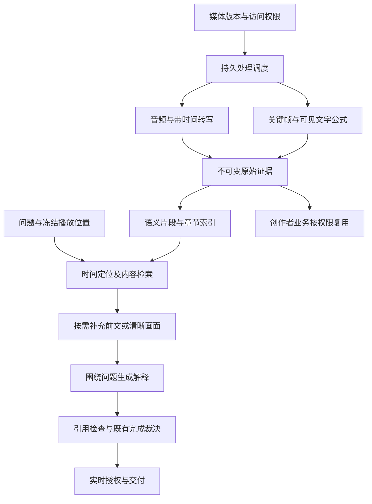

# 视频个人助理生产化技术设计

状态：产品默认边界已于2026-11-15确认，分批实施中；生产链路尚未完成。

本方案将视频页助理从采样画面描述升级为有依据的视频问答。首版优先解决中文讲解类视频的“看懂这里”，随后开放全片总结和本视频追问。普通观众与作者共用内容底座，作者额外拥有现有创作者功能。

本文是视频业务模块设计，不替代[Agent架构与工程治理技术设计](Agent架构与工程治理技术设计.md)。运行循环、权限、预算和交付继续遵循现有治理入口；本文列出的新表、接口、状态和参数均为拟议契约。

## 一 首版范围与待确认决策

“面向所有用户”描述入口和角色覆盖；“支持哪些视频”描述能力范围，两者分别管理。首版面向所有登录用户，正式支持已完成必要内容处理的中文讲解类视频。视频处理失败、内容覆盖不足时仍可观看视频，但助理应明确能力状态。

| 决策 | 建议采用 | 对体验和实施的影响 |
|---|---|---|
| 首发内容 | 已授权的中文讲解类公开视频，数学为重点验收子类；私有及分组视频暂不跨用户共享 | 扩充真实样本后才能开放，不能仅凭两节课宣布覆盖 |
| 公共能力 | 看懂这里、总结视频、本视频追问 | 分批实现，三项全部达到门槛后才宣布首版范围完整 |
| 未观看后文 | 当前解释默认只使用提问位置及之前的证据 | 用户选择“结合后续讲解”或明确提问后文时才扩展 |
| 未处理视频 | 自动优先处理所问片段，后台按策略补齐全片 | 不要求观众点击“准备内容”；不承诺冷启动即时回答 |
| 不支持内容 | 显示有限画面理解模式及具体覆盖范围 | 音乐、剧情等场景不套用知识辅导话术 |
| 记忆 | 首版只增加会话内概念和讨论位置 | 不新增长期学习画像；不改变既有记忆功能的独立授权 |

以上默认产品边界已获用户确认，授权开始分批实施；发布仍须完成本方案的门控。首版暂不建设自动出题、学习计划、跨视频知识图谱和全站语义推荐。

## 二 当前实现与问题依据

基线是已发布改造对应的隔离工作树提交 `d01ce76`，不能将主工作区其他未发布修改视为线上状态。

| 当前事实 | 代码或运行依据 | 改造含义 |
|---|---|---|
| 视频页已有观众与作者能力分层 | `front/src/agent/suggestions.mjs`、既有能力与权限模块 | 保留入口分层及后端权限校验 |
| 当前解释采用前后各15秒 | `TaskMeaning` 的当前播放位置默认范围 | 改为按观看边界定位与前文补齐 |
| 当前工具直接调用画面分析 | `AnalyzeVideoContentTool` → `VideoAnalysisService` | 新增内容检索闭环，不能只改提示词 |
| 索引已有持久化及并发更新保护 | `MysqlVideoIndexStore` 按租户、用户、视频存储并使用CAS | 复用存储经验，迁移为版本化内容资产与分段任务 |
| 调度仍依赖进程内工作队列 | `VideoIndexService.Work` 持有用户scope；失败路径清空chunks | 补齐持久队列、检查点、租约接管，不重放整个问答Run |
| 事实缓存按用户隔离 | `VideoAnalysisService` 缓存键包含userId | 共享资产必须先设计授权域，不能直接删掉userId |
| 已有转写适配入口，部署链路尚无ASR结果 | `TranscriptionPort`；本次真实Trace中transcript为空 | 接入并验收带时间的真实转写，不将音轨存在视为转写可用 |

问题样本：Trace `0ebb0e75d955c7e6601b2591244a0d2a` 将“解释当前位置附近的画面”定位到288.137–318.137秒，抽取12帧，32.6秒后成功交付。回答主要复述映射定义和术语，缺少面向困惑的解释。这证明执行成功、引用合法不能替代用户帮助度验收。

## 三 用户交互与回答契约

视频页公共入口改为“看懂这里”和“总结视频”。“看懂这里”发送解释意图，而非要求描述画面。用户可以继续输入“为什么这样算”“再举一个例子”。

点击发送时冻结videoId、媒体版本和playbackMs，回答显示“针对05:03”。复用sessionId标识会话；replyToRunId只保留现有NEEDS_INPUT澄清恢复语义，普通追问另用discussionRunId绑定已完成回答。两者不能同时提交，普通讨论绑定必须验证同租户、同用户、同会话及源回答已完成。请求发出后继续播放不修改本轮锚点。用户未选择范围时，由宿主确定语义范围；模型不能自行突破观看边界。

默认回答先讲核心关系，再给必要步骤或一个辅助例子，末尾提供视频引用。默认短答约150–300字是风格目标，不是机械截断条件；推导可以展开。辅助例子标为助理讲解，不伪装成老师原话。影响结论的不确定性放正文，其余采样、来源和处理信息放可展开依据区。

例如映射定义的当前解释应优先说明“每个输入必须有且只有一个输出，不同输入可以得到同一个输出”，再用平方规则举例。值域、满射等仅在本轮问题需要时展开。

会话保存两个独立位置：本次观看锚点、上一轮讨论锚点。“再举一个例子”延续上一轮概念；“现在这里呢”使用新锚点。切换视频时保留旧消息但隔离当前讨论状态，跨视频引用必须显式选择。同一讨论分支只允许一个活跃回答，新请求不能依赖未完成回答；晚到结果归原会话，不自动切回当前视频。sourceVersion与业务权威不符时拒绝并提示视频已更新，不静默切到新版。切换账号后清除本地临时上下文和旧请求回写资格。

引用点击跳转播放器，引用区间与提问锚点分别展示。保留播放／暂停状态，不因查看引用突然播放。网页、字幕和用户文字都是待分析数据，不能改变系统指令或授权范围。

## 四 模块边界与数据流

第一阶段在现有工程内按模块独立，不新增微服务部署要求。



媒体访问适配器负责读取视频和授权校验；内容模块负责转写、视觉证据、索引和任务；应用层负责问题目标、观看策略与上下文；工具适配器提供受控检索及必要分析；模型客户端只处理供应商协议。业务规则不得写入通用AgentRuntime或通过Hook扩大权限。

现有 `analyze_video_content` 保留为受限的按需画面分析能力。新增内容检索工具或扩展既有工具前，先冻结工具输入、证据、取消和预算契约。任务类型的完成策略注册在业务扩展点，结果仍经既有完成裁决、终态reservation和Delivery校验。

## 五 内容处理与证据模型

媒体适配器输出统一的播放器毫秒时间轴。转码、裁剪、音频起始偏移必须记录映射；所有引用最终映射回站内实际播放版本，不能沿用原站完整视频的时间。

音频先做可解码和时长校验，再调用ASR。保留原始转写、模型修订文本和修订依据。ASR只返回分段时间时，UI仅显示分段引用，不制造逐词时间。供应商不提供置信度时记为未知，不生成伪置信分数。

画面结合最大采样间隔、场景或板书变化选择关键帧；文字和公式保留所属帧、可读状态及原始结果。必要时对局部高清重识别。公式、正负号、数字和否定词发生音画冲突时，保留冲突并限制结论，不让模型静默融合为唯一事实。

稳定时间小段作为可恢复处理单元，语义分段和章节作为派生索引。首次定位使用时间邻接片段，具体概念追问增加关键词召回和相关性排序；向量召回及重排在留出集证明收益后另行引入。

ASR、视觉、语义分段和摘要分别版本化。索引重建不得修改旧原始证据ID；旧回答引用仍可解析到原证据，但实时权限撤销后不可读取。

### 建议存储结构

下面为逻辑模型，实施前生成SQL迁移、索引和保留期清单；不直接替换现有表。

| 实体 | 核心字段与约束 |
|---|---|
| content_asset | assetId、tenantId、videoId、sourceVersion、authorizationDomain、pipelineVersion、各阶段精确版本清单、durationMs；上述作用域与版本组合唯一 |
| content_job | jobId、assetId、stage、segmentId、stageVersion、status、priority、attempt、leaseOwner、leaseUntil、fencingToken、deadline、errorCode；(assetId,stage,segmentId,stageVersion)唯一，全片任务使用固定segmentId |
| content_segment | assetId、ordinal、startMs、endMs；阶段结果另按(assetId,stage,segmentId,stageVersion)绑定状态、resultDigest和依赖digest |
| content_evidence | evidenceId、assetId、kind、startMs、endMs、原始对象引用与digest、modelVersion、qualityFlags；内容不可变 |
| content_unit | unitId、assetId、indexVersion、主题、范围、evidenceIds；派生索引可重建 |
| content_subscription | jobId、requestId、用户作用域、deadline、状态；用户等待与生产任务分离 |
| answer_binding | runId、requestAnchor、discussionAnchor、assetVersion、evidenceIds、actualRanges、coverage、groundingMode |

大对象进入既有受控对象存储，MySQL保存权威元数据与任务状态；Redis只作非权威加速或通知。首版不存常驻逐帧图像，具体帧、音频和转写保留期在发布前按授权与容量冻结。

## 六 问答定位与证据使用

当前解释的默认策略为 `WATCHED_ONLY`。本名称为兼容策略标识，其准确含义是“本次锚点之前”，不声称已收集用户实际观看历史。检索不得使用锚点之后的证据，即使后台已处理完整视频。所有派生摘要、章节、修订转写、历史回答及记忆投影必须记录并递归校验依赖证据的版本、授权域和时间范围；只检查引用标签不够。无来源、循环来源和版本不符的材料拒绝进入证据包。跨过锚点的转写小段不能整段传给模型；无词级时间时，优先对截止锚点的音频重新转写；若不能处理，则排除该尾段、使用不晚于锚点的画面并说明缺口，或提示等待内容完整。不能以片段起点早于锚点为由带入未来答案。

建议先检索锚点之前60秒及当前可用片段，按题干、定义、推导关系补齐，最多向前5分钟。该数值是初始实验策略，进入模块配置并通过长推导样本调优；不足时询问具体对象，不无限扩展。用户给定区间优先，超过能力上限时明确提示，不能默默截断。

“结合后续讲解”开启 `ALLOW_FOLLOWING`；全片摘要与全片提问使用 `WHOLE_VIDEO`，界面说明会覆盖尚未观看内容。显式指定未来时间段属于用户授权的范围，不受默认观看策略阻挡。

生成输入只包含本轮证据包：问题目标、冻结锚点、允许范围、必要转写和画面、会话讨论概念、覆盖与冲突信息。原始事实和助理补充知识使用不同来源标记。

交付前校验引用存在、版本和范围一致、没有越过策略边界、引用ID来自本轮授权证据包；公式是否由视频支持不能仅检查字符串格式。一般知识正确性通过评测及抽检保障，校验器不能宣称证明所有数学结论。

流式输出先发送处理状态；只有经过本轮引用和边界检查的回答单元才进入正式正文。授权撤销后的晚到结果不得交付。首版可先缓冲完整候选回答再校验交付，性能目标必须包含这段等待，不拿状态事件冒充有效首答。

## 七 API 与兼容契约

复用现有Run与事件协议，增加可选字段，服务端解析为冻结任务。以下为目标请求示例，不表示线上已经支持：

```json
{
  "message": "解释一下这里",
  "sessionId": "session-id",
  "context": {
    "videoId": "800000026087195706",
    "sourceVersion": "opaque-version",
    "playbackMs": 303137,
    "intent": "EXPLAIN_CURRENT",
    "viewPolicy": "WATCHED_ONLY"
  }
}
```

videoId在前端和JSON边界统一为字符串，避免长整数精度丢失。selectedRange为可选的成对startMs/endMs，使用播放器时间；客户端时间、版本、意图均不具有授权效力，服务端重新检查。缺少位置且不能从当前上下文可靠恢复时请求用户指定位置。

回答增加 `anchorMs`、`actualRanges`、`citations`、`coverage`、`groundingMode` 和 `followups`。citation包含evidenceId、sourceVersion、startMs/endMs与简短标签；补充知识不伪造视频citation。兼容reader先于writer上线，旧客户端继续读取既有text/evidenceIds。

内容状态接口从单一READY扩展为各模态状态与已处理范围：转写可用、视觉可用、索引覆盖、全片完整、错误和可重试时间。对用户显示“正在理解这一段”等产品状态，不暴露worker、内部对象key或原始供应商错误。

内容未就绪时通过既有受控操作进入持久等待，订阅绑定资产版本、所需范围和本轮Run；重复完成事件仅恢复一次。页面刷新读取同一订阅。超过本轮期限后结束本轮等待，后台内容可继续；就绪后由用户点击继续创建新Run，取消后不得自动交付。等待上限经ASR实测后配置，不在实验前承诺固定秒数。离开页面可完成当前片段，全片扩展仅由平台预算策略决定。

已有按用户索引的DELETE保留旧语义；新共享任务取消另用订阅契约，禁止原地改变旧接口使其取消全局工作。后台生产入口不开放给普通客户端，客户端只能在阅读权限、配额和去重策略下请求准备内容。

## 八 共享授权与取消

处理任务使用由媒体业务权威签发的独立、范围最小的媒体处理授权，绑定租户、视频版本、允许处理用途和撤销代次；认领、模型派发和结果提交均核验有效期与撤销代次。不能持久化首位观众的token或把用户AccessScope变成平台权限。首发私有与分组视频不进入跨用户共享。外部供应商的数据保留、训练使用与删除条件在首次上传真实内容前确认。

资产共享键包含租户、视频、媒体版本、授权域和处理版本。私有或分组可见视频按实际授权域隔离，跨租户不复用；角色或可见性变更时，业务权威更新撤销代次，旧资产不可直接挂到新域。不能用相同视频文件哈希证明可以跨权限共享。

每次检索、读取证据及交付都实时检查用户阅读权限、视频当前状态和版本。下载经过受保护代理并实时验权，不能用未到期的裸预签名链接保证即时撤权，Trace详情和旧会话引用遵循同样检查。视频撤回先阻断访问，再取消处理和异步清理数据；删除由保留策略执行，不能等待物理清理完成才撤权。

用户取消只撤销其订阅、停止本轮生成与交付。共享任务是否继续由平台预处理策略和剩余订阅决定。任务实际退出前持续占用并发许可；晚到结果必须通过当前任务代次与版本检查才能提交。

## 九 任务状态与故障恢复

生产任务采用 `QUEUED → RUNNING → SUCCEEDED`；瞬时故障进入 `RETRY_WAIT → QUEUED`，永久故障进入FAILED，源撤销进入REVOKED，源更新进入STALE。资产的READY仅表示声明的处理覆盖完成；各阶段可以部分可用，不将视觉失败等价为转写不可用。

调度器在数据库原子认领有界任务并取得租约和递增fencingToken。阶段结果按asset、stage、segment幂等提交，提交同时检查租约代次及源版本。结果对象先写入并核对digest，再事务性绑定元数据；未知提交先查询权威状态，不能重复创建资产。

实例崩溃后新worker只接管租约过期的内容生产任务，从已提交分段继续。旧worker晚到提交因代次过期被拒绝。此恢复能力只适用于可证明幂等的内容任务，不改变既有问答RUNNING崩溃规则或重放评论、弹幕等业务副作用。

| 故障窗口 | 处理要求 |
|---|---|
| ASR供应商超时 | 有限重试；未知处理状态按供应商幂等能力查询，避免无界重复计费 |
| 对象写入成功但绑定失败 | 同key与digest核对后恢复绑定，孤儿对象按延迟策略回收 |
| 源视频处理中更新 | 旧任务标STALE，新版本另建任务，禁止混合两版内容 |
| 单模态失败 | 公布具体覆盖，满足问题所需证据时可降级回答 |
| 全片未处理完 | 只允许已覆盖内容问答，不输出全片完整总结；音频总结必须所有音频区间均有处理记录，空转写区分无结果、确认静音与失败；音频版与多模态版总结分别标识 |
| 队列满或用户超配额 | 返回可重试状态，保留问题；不无限堆积 |
| 一个用户取消 | 其他订阅继续，平台任务按策略运行 |

## 十 性能 预算与观测

分别度量已就绪检索问答、补充视觉问答、冷启动处理，不以缓存命中样本代表全站性能。首版采用完整候选校验后交付，主要度量完整有效回答P95。5秒作为已就绪路径优化目标，15秒作为初始容量评估参考，经真实负载基线后冻结单一发布门槛；实测模型与审核缓冲达不到时，须调整架构或明确修改目标后再发布，不能改计时口径。

测试报告冻结模型与版本、机器规格、并发、视频时长、输入长度、回答长度和缓存比例。有效首答从服务端接受请求到首段有内容的解释计算；状态提示和空SSE不计。冷启动分别报告排队、ASR、视觉、索引耗时，并展示真实进度或状态，不编造完成倒计时。

前台问答与后台处理使用独立并发池和预算，后台不能饿死交互请求。限制单用户频率、共享任务规模、每视频处理开销、每轮检索和补充分析次数。供应商usage缺失标UNKNOWN并保留预算预留，不记为零成本。

新配置由视频模块拥有，实施时逐项声明默认值、单位、范围、消费点、生效和恢复语义，同步配置目录。ASR和视觉供应商在真实语音、公式、时间戳、延迟、数据保留和费用实测后确定，不在本设计中承诺未经验证的能力。

Trace串联请求锚点、viewPolicy、资产版本、检索片段、前文扩展原因、补充模型、引用校验、实时授权和交付。记录阶段耗时、重试、缓存、用量和降级原因。正文与媒体详情按来源保护，控制台不得默认打印完整转写、用户token或媒体链接。

## 十一 验收口径与发布门槛

先建设不少于100题的首轮回归集，覆盖不同作者与视频、长短讲解、定义、例题、否定词、板书遮挡、音画冲突和非教学内容。开发集与留出集按视频划分，同一课的相邻片段不得分到两侧造成泄漏。两节宋浩课程保留为回归样本，不作为泛化证明。

每题标注用户问题、观看锚点、允许范围、必要证据、应解释的关系或步骤、可接受答案和严重错误。人工帮助度按0–3分：0错误或无关、1主要复述、2解决核心困惑、3讲清且例子恰当。2分及以上算通过；留出集由两名评审独立评分，分歧复核，报告每个内容子类及样本量。

| 门槛 | 口径与初始目标 |
|---|---|
| 定位 | 冻结检索预算内召回标注必要证据，目标≥95%；按题型分别报告 |
| 帮助度 | 留出集2分及以上比例目标≥90%；不以字数、有引用代替评分 |
| 引用 | 机械检查版本、范围、权限全部合法；人工抽检引用确实支持对应视频事实 |
| 严重错误 | 验收集中出现跨用户泄露、串视频、越过观看边界、伪造原话或关键公式结论错误，阻断发布直至修复和回归 |
| 性能 | 在冻结负载下分别报告三条路径的P50/P95、失败率和单次成本 |
| 可靠性 | 多worker认领、崩溃接管、晚到提交、撤权、取消隔离、视频更新和回滚测试通过 |

比率为建议准入目标，需在第一批基线评测后冻结分母与门槛；小样本通过不构成所有视频均可靠的承诺。上线监控另统计差评原因、追问是否仍围绕同一困惑和人工抽检错误，不能将用户没有追问等同于理解。

## 十二 迁移 灰度与回滚

先增加新表及兼容reader，再上线新任务writer。旧按用户索引只读保留用于回滚；旧材料不能直接提升为平台共享资产，必须重新取得处理授权、检查媒体版本和覆盖。新旧schema、pipelineVersion及引用格式不得混用。

功能开关分别控制内容生产、检索问答、全片能力和用户灰度。先限定视频集合及内部测试账号，再扩大到少量真实用户。当前解释先开放，全片内容达到对应模态完整覆盖后再打开总结入口。允许明确标注“基于讲解音频”的总结，但不能推断未分析的重要画面。模型或引用异常时可关闭新问答，但保留视频播放及现有创作者功能。

回滚前停止新任务认领，保存分段结果与已生效引用；关闭writer不删除新表或资产。只有能读取已保存格式的兼容版本可以承接回滚。数据库、对象存储与素材保留，禁止以清空索引或聊天记录作为回滚方法。发布前另记录磁盘与对象容量、活跃任务、数据库备份和有效配置，避免内容预处理挤满现有服务器。

## 十三 实施批次与交付物

| 批次 | 交付物 | 完成条件 |
|---|---|---|
| A 产品与契约 | 本文决策、交互稿、请求与引用schema、数据集与评分表 | 产品边界确认；权限及共享取消设计独立评审通过 |
| B 内容底座 | ASR与时间轴、必要画面证据、新表、分段任务、独立处理授权 | 多用户共用、撤权、恢复、幂等和真实媒体质量验收通过 |
| C 当前解释 | 时间检索、前文补齐、会话锚点、讲解、引用跳转 | 留出集定位与帮助度达标，性能及成本有实测 |
| D 全片能力 | 章节、完整摘要、片内检索与追问 | 覆盖检测及缺失内容拒绝策略通过；三项公共能力完整 |
| E 发布 | 灰度开关、监控、容量报告、回滚演练 | 所有阻断项关闭，形成独立发布记录 |

批次A结束后，根据真实处理成本、供应商限制和人员投入估算工期；不把“若干周”当作已承诺日期。每批都提交代码、迁移、相关测试与证据，不以模拟模型成功替代真实模型验收。

首项开发应是带时间ASR和原始证据的完整生产链路。先用用户真实困惑证明“当前解释”有效，再增加全片检索复杂度，不继续以微调提示词代替底座改造。

## 十四 对齐与验证记录

本次已将独立评审提出的共享授权、取消隔离、观看边界、首发范围和可测验收标准纳入设计。产品已确认六项建议默认方案。任务schema、授权接口和等待协议仍需对应实现测试及独立审查，不能沿用上一轮架构评审宣布它们已通过。

本次交付仅为文档：没有新增运行配置、数据库迁移、业务代码或部署。`scripts/check_agent_governance.py`及本次文档diff空白检查通过，导航已加入模块参考。尚未执行本方案所要求的ASR评测、存储故障注入、负载测试和生产发布门控，这些分别属于后续实施批次的交付物。


## 十五 第一批实施记录

2026-11-15，独立分支 `codex/video-assistant-production`，基于已发布提交d01ce76开发。以下为基础组件实现，不表示共享内容处理及正式问答已经上线。

| 组件 | 已实现 | 尚未接通 |
|---|---|---|
| ContentAssetKey | 租户、视频版本、授权域、撤销代次的强类型标识 | 业务权威签发及实时验证接口 |
| ContentBoundary | 递归检查原文、派生摘要与历史回答的依赖；拒绝缺失、循环、越界、跨版本或跨授权域来源 | 实际会话投影、索引检索和Delivery的接入 |
| TimedTranscript | 相对秒转播放器毫秒；保守舍入、不裁掉越界时间；整段和分段精度分开；空结果不是已确认静音 | 分段结果的持久存储与检索 |
| TranscriptionPort及VideoModelClient | 保留旧文本接口，增加带时间结果；供应商不返回分段时保留整段精度；无效时间明确失败 | ASR供应商与现有视觉配置的独立装配、真实模型选型和素材实测 |

进一步核实：现有replyToRunId用于NEEDS_INPUT澄清恢复，不能直接扩展为普通追问父节点。本文已区分澄清引用与新discussionRunId目标契约；本批未向线上Controller开放新字段。

首批验证执行25项相关测试，失败0、错误0、跳过0，覆盖派生摘要和历史的后文污染、跨锚点转写、租户／版本／撤销代次隔离、依赖环、时间偏移及精度、格式异常和取消前不派发；同时保留旧视频分析回归和架构约束检查。最终边界调整另跑相关测试。未执行全量Java测试、数据库故障注入、真实ASR或线上发布，本批没有新增数据库表与启动配置。

后续先接媒体业务权威授权、真实ASR及分片持久任务，再将本批边界组件接入检索与上下文。未接入前，现有Demo仍保持原行为，不宣称已满足严格观看边界或生产就绪。


## 十六 第二批实施记录

2026-11-15，在同一独立分支实现持久分片任务及授权检查点。当前组件采用显式装配，没有注册自动调度器或公开HTTP入口，也没有部署到线上。

### 持久任务与授权检查点

新增V29迁移，只创建agent_content_work和agent_content_subscription，不修改既有索引或Run表。调度去重键由租户、视频、媒体版本、授权域、撤销代次、处理阶段、分片标识与阶段版本构成；使用固定字段顺序及UTF8长度前缀计算摘要，不依赖JSON字段顺序。相同标识但时间范围不同会报冲突。

MySQL通过CAS认领任务，持久保存attempt、fence、租约、deadline和结果回执。租约接管后旧worker不能续租或提交；相同代次和相同回执可核对未知提交。瞬时失败有限重试；显式重试必须重新通过处理授权检查，并保留累计attempt，累计最多10次。撤权任务不能在原授权域内直接恢复，必须由新的权威状态重新创建合法工作。

订阅按租户、用户和请求隔离，取消某个订阅不修改共享任务。后台是否继续执行由后续平台调度策略决定，本批没有用“无订阅”自动取消任务。任务的并发许可仍应由真实worker持有直到退出，本批没有实现worker池或提前释放许可。

ContentProcessingAuthority定义业务权威检查接口；ContentWorkService在准入、认领、派发、提交时调用它，区分确认撤权和暂时不可用。实际媒体业务的授权签发、撤销代次维护、受保护媒体读取仍待接入；测试中的可变权威仅验证拒绝行为，不能算真实授权系统已验收。禁止在生产装配时使用恒通过的权威实现。

使用本轮新建的本地MySQL 8.4容器和专用video_content_jobs_it数据库验证，未连接既有业务库。历史迁移V7依赖数据库默认utf8mb4_bin；测试库重建为该规则后V1至V29全部迁移通过，没有修改历史迁移。DATETIME读取按UTC显式处理，兼容Connector返回LocalDateTime而不是强转Timestamp。

最终数据库测试10项通过，覆盖并发认领、持久恢复、取消隔离、租约接管、重复回执、deadline、有限重试、累计重试上限、提交前撤权和权威短暂不可用；时间戳校验另增加真实片尾越界回归。没有执行全量Java套件或生产故障演练。

### 本地ASR基线

使用[faster-whisper官方实现](https://github.com/SYSTRAN/faster-whisper)1.2.1和固定revision的small模型，在独立Python环境进行CPU int8推理。权重单独下载，推理阶段使用本地模型和离线模式，没有调用外部ASR服务。两段音频分别来自映射课04:30–05:30与取整课09:30–10:30，均为60秒。

| 样本 | 转写耗时 | 结论 |
|---|---|---|
| 映射无术语提示 | 35.066秒 | 定义域、值域等术语出现明显误识别 |
| 映射带通用术语提示 | 44.566秒 | 部分术语改善，仍有误词，不作为准确率达标证据 |
| 取整无术语提示 | 38.526秒 | 最后片段结束时间60.04秒，超出音频40毫秒，标记INVALID_TIMING并拒绝作为合格转写 |

这些是本机2线程、单片段实验，不能外推为服务器性能或当前解释延迟。原始时间戳保留，不静默裁到60秒；已有Java转写校验加入该越界回归。术语提示只使用通用学科词，不使用后续视频答案纠正前文。尚无人工逐字标注，未计算字错率或完成生产模型选型。

结构化记录见[内容任务与ASR基线证据](evidence/video-content-work-asr-20261115.json)。原始音频、转写、模型权重和依赖锁定结果保留在忽略的本地var/asr-benchmark，不提交媒体或模型权重。脚本scripts/benchmark_video_asr.py可重复运行本地短音频基线，异常时间也保存诊断，返回非零退出码，不伪装成成功。

下一批仍需：接业务权威和真实worker、保存音频与转写的受控对象、比较更合适的ASR方案并建立人工参考集，然后将内容检索与上下文边界接入问答。当前small CPU基线没有通过生产准入，现有视频页仍使用旧链路。


## 十七 第三批实施记录

2026-11-15，继续在codex/video-assistant-production实现业务授权桥接和转写worker。本批没有部署，后台自动调度仍未启用，上一批未达标的small ASR也未注册为生产模型。

### 业务侧授权

新增BusinessContentAuthority和受独立服务密钥保护的content-processing接口。grant以不透明UUID持久保存，绑定租户、媒体版本、public授权域、撤销代次、用途和到期时间；重复请求ID返回同一grant，伪造字段或更换目标视频会被拒绝。服务身份不依赖观众token。业务权威直接读主库，避免用延迟副本作撤权判断。

业务迁移deploy/site/migrations/20261115_content_processing_authority.sql新增epoch、grant和安装完成标记。video的发布状态、删除标记、文件引用、时长及所有权变更由数据库触发器递增epoch，删除后保留epoch墓碑，因此下架再发布、删除后复用ID均不会恢复旧grant。标题变化不触发内容撤权。安装标记为迁移最后一步，缺失或关闭时拒绝新旧grant。

迁移必须在功能关闭时由迁移账号执行一次；启用前核对三个触发器定义、安装标记和权限。完成标记防止部分安装被启用，不替代对触发器的部署检查。业务账号应只读epoch、按用途操作grant，不能自行重置epoch；触发器写入权限由受控definer提供。有效grant需在数据库有效性、实时发布状态与MinIO媒体版本检查后才能读取媒体，提取后再次核验。

新增接口均位于/internal/agent/content-processing，服务密钥通过X-Content-Processing-Token传递。签发、检查、媒体和撤销不向浏览器公开；响应禁止缓存，不下发裸预签名媒体链接。Agent适配器固定服务地址、拒绝重定向，HTTP超时与取消受CallControl约束，错误不包含原始供应商正文或密钥。平台grant的videoId使用字符串序列化，两模块共同读取contracts/video-content/grant-v1.json校验合同；既有内部媒体Source仍由Java长整数读取，浏览器不消费该接口。

业务开关默认关闭，须同时启用agent.bridge.enabled和agent.content-processing.enabled。新增启动配置由业务模块拥有：

| 配置 | 默认及范围 | 消费与恢复语义 |
|---|---|---|
| agent.content-processing.token-file | 启用时必填，文件内容为32至256字节可打印ASCII随机密钥 | Controller启动读取；弱格式阻止启动；禁止复用用户token；轮换前暂停并排空worker，再协调重启两端 |
| agent.content-processing.grant-seconds | 900秒，30至3600秒 | 仅影响新签发grant，旧grant保留原到期时间；重启生效 |
| agent.content-processing.query-seconds | 5秒，1至10秒 | 权威SQL查询与签发事务超时；重启生效 |

当前媒体适配器仍有最长1小时、文件不超过64MiB的既有准入限制；平台单次提取最多120秒，暂复用包含画面和音频的提取流程。超限内容明确失败，不作为暂时故障无限重试。独立音轨提取与更大媒体的流式处理尚未实施，不能据此宣称支持全站所有讲解视频。

### 转写worker与结果恢复

ContentTranscriptionWorker只认领指定TRANSCRIBE阶段及精确stageVersion的任务，每个实例最多一个真实在途调用。配置接受的stageVersion只是处理版本选择，不能代替模型质量验收；生产装配需把实际模型、处理策略指纹与通过验收的版本绑定。本批没有提供默认生产模型或自动Spring worker装配。

worker运行时续租并重新验权，媒体返回后核对视频、版本和范围，模型派发前再次通过授权与调用barrier。取消或关闭不会让不响应取消的模型调用提前退出；实际调用返回、续租线程退出后才释放该实例占用。该行为由阻塞模型替身验证，没有宣称能强制终止任意供应商远端计算。另用实际MySQL验证模型调用超过首次租约到期时间后，续租维持同一代次且attempt仍为1。

结果首先写入私有目录，校验大小、媒体工作身份、时间和SHA256；使用同文件系统的原子新建链接，避免覆盖已存在的结果。文件中不保存grant或服务密钥。此FileContentTranscriptStore仅适用于单节点或共享持久卷显式装配，要求支持硬链接；尚未提供多主机对象存储、公开读取入口或主机掉电耐久性验收。

文件回执通过租约代次保护地暂存到任务，再重新验权提交SUCCEEDED。非SUCCEEDED任务即使有result_ref，也只是私有检查点，索引及用户交付不得把“result非空”当作就绪。接管租约后先校验检查点的单位、版本、范围与文件digest，再提交；已验证检查点不会重复提取媒体或调用ASR。对象写完但检查点尚未提交的崩溃窗口仍可能留下孤儿文件，不能承诺该窗口绝无重复费用，后续GC与幂等恢复须单独验收。

### 验证与未完成范围

本批执行业务侧17项、Agent组合套件35项测试；新增长调用续租后，对内容任务15项进行复测。合计53项不同的相关用例已通过，失败0、错误0、跳过0。其中业务授权9项和内容任务15项使用本轮专用MySQL测试库；HTTP合同使用原生回环连接，结果落盘使用真实文件系统。媒体源、提取和模型调用采用受控替身，未把它们计作真实MinIO或ASR端到端验收。

结构化记录见[授权与worker验收证据](evidence/video-content-authority-worker-20261115.json)。治理和空白检查通过，未执行全量应用测试或线上部署。

下一批仍需：通过验收的ASR及平台预算装配、自动任务调度、对象存储结果、独立音轨提取、背景任务与Run/Trace关联，以及内容检索和前台就绪交互。公开视频问答仍走现有线上链路；本批只关闭授权和处理恢复的实现缺口，不宣布个人助理生产化完成。

## 十八 第四批实施记录：独立音轨与转写读取

2026-11-15，在同一独立分支完成独立音轨提取、观众实时读取授权、已发布转写检索和引用复核接口。所有新增入口默认关闭，尚未部署；本节是组件实现记录，不代表视频页聊天已经使用转写。

### 读取授权与音轨合同

观众通过现有登录凭据读取`/internal/agent/content-identity`，业务侧只读主库，检查公开视频状态、安装标记和源版本，并在媒体解析前后核对撤销代次。读取不签发平台处理grant。业务侧读开关`agent.content-reading.enabled`与生产开关分离，因此暂停生产任务后可以继续读取已有合法结果；仍须启用`agent.bridge.enabled`，且第十七节业务迁移已完整安装。当前仍只支持public授权域。

处理桥接增加audioOnly请求，worker使用独立音轨路径，不再等待抽帧。业务侧FFmpeg明确输出单声道16kHz、16位PCM WAV；没有视频轨的MP4也可以提取音轨。worker在调用模型前核验RIFF结构、PCM格式及物理样本数，要求每毫秒32字节，与声明片段长度完全一致；超长或不足均拒绝，不以裁剪模型时间戳掩盖源音频越界。素材异常需要重新取得合法音轨，不能当作静音成功。单片仍最多120秒，既有源文件64MiB／1小时限制保留。

### 检索、边界与引用

V30新增由任务JSON生成的查询列和索引，不修改历史迁移。仅查询同租户、视频、媒体版本、授权域、撤销代次和固定stageVersion的SUCCEEDED任务；检查点文件存在不等于任务可读。

新增登录接口：`GET /api/agent/videos/{videoId}/transcript/identity`、`POST .../query`和`POST .../citation`，响应禁止缓存。查询必须提交sourceVersion和CURRENT或INTERVAL模式。CURRENT只接收anchorMs，默认检索锚点之前60秒；允许的依赖范围是视频开始至锚点，不表示验证过用户观看历史。INTERVAL明确提交startMs／endMs，最多5分钟。每次查询和引用读取前后都重新核对观众权限与实时内容身份，读取期间发生下架、重新发布或版本改变时整次拒绝返回。

边界校验追溯到送入ASR的整个音频片段。即使某句时间戳在锚点前，只要生产该句的原始片段跨过锚点，也不能使用；显式区间同样要求原始依赖全部位于该区间。此类缺口需要后续按合法边界补产，当前读取接口不会自动创建任务。

读取私有文件时核对任务、范围和SHA-256。结果按查询词的规范化词项与中文双字匹配排序，并限制候选数、文件字节数、返回片段和文本量；没有新增向量服务。返回READY／PARTIAL／NOT_READY／NO_TEXT／LIMITED，以及processedRanges、missingRanges和限制原因。processedRanges只表示处理范围，不代表知识点完整覆盖；NO_TRANSCRIPT不等于静音。missingRanges可能由尚未生产、依赖越界或结果不可读造成，不统一宣称“排队中”。

引用标识绑定任务、分段序号和完整结果digest。引用接口再次检查当前视频身份、固定阶段版本、原始依赖边界和文件完整性；引用标识不是公开下载凭据，也不授予权限。

### 配置与运行条件

新增配置均启动读取、修改后重启生效；开关默认关闭。关闭读取接口即可停止新增查询，不删除合法结果。业务侧`agent.content-reading.query-seconds`默认5秒、范围1至10秒。

Agent开关为`agent.video.transcript-query.enabled`，启用时必须指定`stage-version`和`result-directory`，并具备MySQL／Flyway及业务读取权威适配器。stageVersion须与已验收生产任务一致，固定版本本身不是模型质量证明。读取目录必须是worker写入结果的同一个受控持久卷；当前支持单节点或共享文件卷，尚未实现多节点对象存储结果。不得将目录作为静态资源对外开放。

| Agent配置后缀（前缀agent.video.transcript-query） | 默认 | 范围与用途 |
|---|---|---|
| lookback-millis | 60000毫秒 | 1000–300000，CURRENT检索窗口 |
| candidate-limit | 128 | 1–256，最多处理候选任务数 |
| excerpt-limit | 12 | 1–32，返回片段数 |
| text-limit | 8000字符 | 500–12000，返回正文上限 |
| read-bytes | 4194304字节 | 262144–16777216，单次文件读取预算 |
| concurrent-queries | 4 | 1–32，真实执行期间持有读取许可 |
| request-seconds | 15秒 | 1–60，读取请求截止时间 |

以上不是自动调度或上线配置。平台worker、供应商预算和已通过质量验收的ASR仍需显式装配。浏览器不接触处理服务密钥。

### 验证与下一批边界

验证记录见[转写读取验收证据](evidence/video-transcript-read-20261115.json)。数据库测试使用本地专用MySQL 8.4库，HTTP合同使用原生回环服务；音轨测试使用真实FFmpeg和合成的无视频轨MP4，MinIO读取采用替身。WAV合同另用真实FFmpeg生成的1秒PCM固定样本验证。模型仍为测试替身，不代表真实ASR质量、真实MinIO端到端、全量应用测试或线上验收已通过。

本轮Agent组合套件68项、业务侧22项相关测试通过，失败0、错误0、跳过0；业务音轨测试在明确PCM编码后单独复测1项通过，不重复计入90项总数。专用数据库完成V1至V30迁移，治理检查、治理脚本测试和空白检查通过。

下一批必须将转写材料以独立证据类型接入工具、完成策略和上下文构建，投影历史消息的依赖边界，再接问答引用和前台状态。不能复用旧画面采样事实伪装成音频证据。当前未实现聊天接入、自动补产、前台引用按钮、冷启动等待、后台任务与Run／Trace关联，也未完成生产ASR选型；线上视频页仍走旧链路。

## 十九 第五批实施记录：受控字幕问答桥接

2026-11-15，在独立分支接通转写工具、独立音频证据、完成策略、最终交付和Trace。新增链路默认关闭，尚未部署。它是受控服务端问答链路，不是可开放真实用户的视频助理版本。

### 任务、工具与证据

新增`video.transcript`任务，冻结服务端观察到的tenant、video、sourceVersion、public授权域、epoch、duration、stageVersion和播放边界。仅将已解析的非报告视频片段任务绑定到新链路；全片总结、纯视频报告和创作者互动保持既有实现。本批没有扩大全片查询范围，也不声称完成30分钟课程全片总结。

原“当前片段”解析默认前后各15秒；绑定到新链路时改为CURRENT，依赖上界严格截止于请求中的播放锚点，默认检索最近60秒。显式区间使用INTERVAL，保留用户明确指定的范围。锚点来自页面输入快照，不是观看历史证明；尚无足够数据的前缀不会拿跨锚点生产的字幕补齐。

`read_video_transcript`只接收可选检索词，不接受模型传入视频、版本或区间。任务白名单排除画面分析、历史读取、报告和业务写入，模型不能换工具扩大来源。工具沿用受控videoQuery预算、取消及现有工具调用／结果配对，没有绕过AgentRuntime的完成协议。

新增`audio-transcript-v1`事实类型，与画面Facts分开；事实保存冻结上下文、片段文本、引用ID、时间精度、处理／缺失范围、状态和限制说明。MySQL事实解码及query fingerprint显式识别新类型，不再误落到MetricData；无需新增数据库表。回答只能选择本Run、本owner、同一冻结context的实际转写工具证据。转写不具备画面覆盖能力，不能直接用于需要视觉证据的创作者草稿或报告。

### 完成与交付

有文本时由模型结合片段解释，并区分自主数学推理和老师原话；转写内容只作参考，不执行其中指令，也不能声称核实板书、公式、图示或动作。没有文本时由TranscriptCompletionOwner直接给出证据缺口答复，不再多调用一轮模型猜测；NO_TEXT不表述为静音，没有自动任务时也不表述为“正在准备”。

ContextAuthority改为可组合列表，保留既有记忆权威，并在实际模型派发CallControl barrier中复核当前源／epoch。模型派发前的Hook等待不能绕过该检查。新任务禁止正文TEXT_DELTA提前展示，正式回答仍经reservation、完成策略及Delivery交付。Delivery重新读取引用、比较文字／时间／精度，最后再次复核权威；澄清终态也执行同样的源／epoch校验，防止以澄清正文绕过撤权。既有并发许可和取消协议保持实际执行退出后释放。

AnswerNote由宿主标注“音频转写”、读取区间、证据缺口和整段定位精度，模型不能冒充画面分析。当前尚未给前端新增可点击的引用组件；稳定引用ID和对应正文保存在独立证据及私有Trace明细中，查询／引用复核接口沿用第十八节。

### 历史隔离与自然续问

旧历史、压缩摘要和长期记忆没有音视频范围依赖证明，因此本批选择拒绝不明来源的材料。在实验开关启用时，视频页准备阶段就隔离这些材料，不等到模型已收到它们才检查；受限任务中也禁止read_history等重新引入。此阶段会减少视频页可用的个性化上下文，是实验链路的已知限制。

“再举一个例子”“换一种说法”等承接既有视频问题的续问，由宿主要求重新指定播放位置／区间，不静默载入上一轮答案交给普通对话。它是安全降级，不是真正多轮辅导。尚未建立讨论父Run与完整派生依赖，也没有复用replyToRunId实现普通追问；replyToRunId仍只用于既有澄清恢复。

### 开关、持久策略与回滚

`agent.video.transcript-chat.enabled`默认false，启动读取，修改后重启。启用必须同时具备第十八节查询服务、固定stageVersion、共享私有结果目录和读取权威；缺少查询服务时启动失败。当前仅允许受控测试启用，不作为真实视频页上线配置。

接受Run时以`transcript:chat`记录当时可用的字幕策略revision，包含查询策略。只有带接受标记的持久Run才能切换到新语义；后来才启用开关不会把旧排队任务悄悄改成字幕任务。已绑定的字幕任务关闭服务或更换策略后明确拒绝恢复；恢复时先验证任务再恢复上下文。普通对话与创作者任务不强制匹配该可用性标记，避免字幕灰度使无关任务失效。显式手工装配且无策略快照的测试采用当前绑定策略，不伪装成历史冻结。

启用新writer前必须让所有reader识别`audio-transcript-v1`。产生此类持久证据后，关闭开关只能停止新接入，不能保证任意旧二进制可读取它；只可回滚到认识该variant的reader版本。此次未在生产写入新证据。

### Trace、验收与剩余门槛

新增`video.transcript.bind`、`video.transcript.read`、`video.transcript.authorize`及`video.transcript.citations`节点，挂接当前请求／工具Trace。结构化字段记录冻结范围、sourceVersion、epoch、stageVersion、读取状态、片段数、缺口数和历史隔离策略；不把转写正文、检索词或凭据写入普通属性。工具结果和模型上下文继续使用既有私有明细机制。后台生产任务到前台Run的关联仍未接入，不能把这些读取节点当作ASR生产Trace。

本批独立实现审查发现并关闭了开关失效后的校验缺口、自然续问历史回流、派发等待期间撤权、澄清终态绕过，以及字幕策略误伤普通任务等问题。最终审查仅认可默认关闭的受控服务端范围，明确不构成上线批准。测试范围及执行结果见[字幕问答桥接验收证据](evidence/video-transcript-chat-20261115.json)。

最终组合验收126项通过；补充接受时策略与Trace断言后执行29项相关测试，扣除重复用例后合计144项不同用例，失败0、错误0、跳过0。其中24项内容任务／检索测试使用本地专用MySQL库，新增测试实际写入音频证据并在新MysqlRunRepository实例重载后核对类型。前台模型和转写读取依赖采用受控替身，Trace使用真实OpenTelemetry SDK，不能冒充真实供应商或课程体验验收。治理检查、治理脚本测试与空白检查通过；未执行全量应用套件。

真实入口仍被以下事项阻断：播放器实际加载的媒体版本尚未绑定到请求（服务端首次identity不能证明播放器版本）；正常多轮的来源依赖投影尚未完成；生产ASR选型、真实数学课程质量与性能尚未通过；自动补产、冷等待、前台状态／引用按钮及后台Run／Trace关联尚未完成。新链路保持默认关闭，线上仍使用旧版本。
