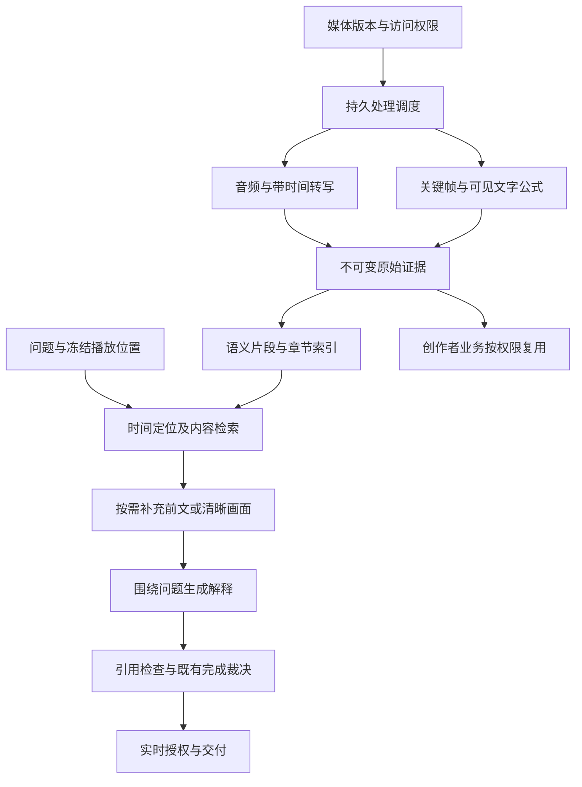

# 视频个人助理生产化技术设计

状态：产品默认边界已于2026-11-15确认，分批实施中；生产链路尚未完成。

本方案将视频页助理从采样画面描述升级为有依据的视频问答。首版优先解决中文讲解类视频的“看懂这里”，随后开放全片总结和本视频追问。普通观众与作者共用内容底座，作者额外拥有现有创作者功能。

本文是视频业务模块设计，不替代[Agent架构与工程治理技术设计](Agent架构与工程治理技术设计.md)。运行循环、权限、预算和交付继续遵循现有治理入口；本文列出的新表、接口、状态和参数均为拟议契约。

## 一 首版范围与待确认决策

“面向所有用户”描述入口和角色覆盖；“支持哪些视频”描述能力范围，两者分别管理。首版面向所有登录用户，正式支持已完成必要内容处理的中文讲解类视频。视频处理失败、内容覆盖不足时仍可观看视频，但助理应明确能力状态。

| 决策 | 建议采用 | 对体验和实施的影响 |
|---|---|---|
| 首发内容 | 已授权的中文讲解类公开视频，数学为重点验收子类；私有及分组视频暂不跨用户共享 | 扩充真实样本后才能开放，不能仅凭两节课宣布覆盖 |
| 公共能力 | 看懂这里、总结视频、本视频追问 | 分批实现，三项全部达到门槛后才宣布首版范围完整 |
| 未观看后文 | 当前解释默认只使用提问位置及之前的证据 | 用户选择“结合后续讲解”或明确提问后文时才扩展 |
| 未处理视频 | 自动优先处理所问片段，后台按策略补齐全片 | 不要求观众点击“准备内容”；不承诺冷启动即时回答 |
| 不支持内容 | 显示有限画面理解模式及具体覆盖范围 | 音乐、剧情等场景不套用知识辅导话术 |
| 记忆 | 首版只增加会话内概念和讨论位置 | 不新增长期学习画像；不改变既有记忆功能的独立授权 |

以上默认产品边界已获用户确认，授权开始分批实施；发布仍须完成本方案的门控。首版暂不建设自动出题、学习计划、跨视频知识图谱和全站语义推荐。

## 二 当前实现与问题依据

基线是已发布改造对应的隔离工作树提交 `d01ce76`，不能将主工作区其他未发布修改视为线上状态。

| 当前事实 | 代码或运行依据 | 改造含义 |
|---|---|---|
| 视频页已有观众与作者能力分层 | `front/src/agent/suggestions.mjs`、既有能力与权限模块 | 保留入口分层及后端权限校验 |
| 当前解释采用前后各15秒 | `TaskMeaning` 的当前播放位置默认范围 | 改为按观看边界定位与前文补齐 |
| 当前工具直接调用画面分析 | `AnalyzeVideoContentTool` → `VideoAnalysisService` | 新增内容检索闭环，不能只改提示词 |
| 索引已有持久化及并发更新保护 | `MysqlVideoIndexStore` 按租户、用户、视频存储并使用CAS | 复用存储经验，迁移为版本化内容资产与分段任务 |
| 调度仍依赖进程内工作队列 | `VideoIndexService.Work` 持有用户scope；失败路径清空chunks | 补齐持久队列、检查点、租约接管，不重放整个问答Run |
| 事实缓存按用户隔离 | `VideoAnalysisService` 缓存键包含userId | 共享资产必须先设计授权域，不能直接删掉userId |
| 已有转写适配入口，部署链路尚无ASR结果 | `TranscriptionPort`；本次真实Trace中transcript为空 | 接入并验收带时间的真实转写，不将音轨存在视为转写可用 |

问题样本：Trace `0ebb0e75d955c7e6601b2591244a0d2a` 将“解释当前位置附近的画面”定位到288.137–318.137秒，抽取12帧，32.6秒后成功交付。回答主要复述映射定义和术语，缺少面向困惑的解释。这证明执行成功、引用合法不能替代用户帮助度验收。

## 三 用户交互与回答契约

视频页公共入口改为“看懂这里”和“总结视频”。“看懂这里”发送解释意图，而非要求描述画面。用户可以继续输入“为什么这样算”“再举一个例子”。

点击发送时冻结videoId、媒体版本和playbackMs，回答显示“针对05:03”。复用sessionId标识会话；replyToRunId只保留现有NEEDS_INPUT澄清恢复语义，普通追问另用discussionRunId绑定已完成回答。两者不能同时提交，普通讨论绑定必须验证同租户、同用户、同会话及源回答已完成。请求发出后继续播放不修改本轮锚点。用户未选择范围时，由宿主确定语义范围；模型不能自行突破观看边界。

默认回答先讲核心关系，再给必要步骤或一个辅助例子，末尾提供视频引用。默认短答约150–300字是风格目标，不是机械截断条件；推导可以展开。辅助例子标为助理讲解，不伪装成老师原话。影响结论的不确定性放正文，其余采样、来源和处理信息放可展开依据区。

例如映射定义的当前解释应优先说明“每个输入必须有且只有一个输出，不同输入可以得到同一个输出”，再用平方规则举例。值域、满射等仅在本轮问题需要时展开。

会话保存两个独立位置：本次观看锚点、上一轮讨论锚点。“再举一个例子”延续上一轮概念；“现在这里呢”使用新锚点。切换视频时保留旧消息但隔离当前讨论状态，跨视频引用必须显式选择。同一讨论分支只允许一个活跃回答，新请求不能依赖未完成回答；晚到结果归原会话，不自动切回当前视频。sourceVersion与业务权威不符时拒绝并提示视频已更新，不静默切到新版。切换账号后清除本地临时上下文和旧请求回写资格。

引用点击跳转播放器，引用区间与提问锚点分别展示。保留播放／暂停状态，不因查看引用突然播放。网页、字幕和用户文字都是待分析数据，不能改变系统指令或授权范围。

## 四 模块边界与数据流

第一阶段在现有工程内按模块独立，不新增微服务部署要求。



媒体访问适配器负责读取视频和授权校验；内容模块负责转写、视觉证据、索引和任务；应用层负责问题目标、观看策略与上下文；工具适配器提供受控检索及必要分析；模型客户端只处理供应商协议。业务规则不得写入通用AgentRuntime或通过Hook扩大权限。

现有 `analyze_video_content` 保留为受限的按需画面分析能力。新增内容检索工具或扩展既有工具前，先冻结工具输入、证据、取消和预算契约。任务类型的完成策略注册在业务扩展点，结果仍经既有完成裁决、终态reservation和Delivery校验。

## 五 内容处理与证据模型

媒体适配器输出统一的播放器毫秒时间轴。转码、裁剪、音频起始偏移必须记录映射；所有引用最终映射回站内实际播放版本，不能沿用原站完整视频的时间。

音频先做可解码和时长校验，再调用ASR。保留原始转写、模型修订文本和修订依据。ASR只返回分段时间时，UI仅显示分段引用，不制造逐词时间。供应商不提供置信度时记为未知，不生成伪置信分数。

画面结合最大采样间隔、场景或板书变化选择关键帧；文字和公式保留所属帧、可读状态及原始结果。必要时对局部高清重识别。公式、正负号、数字和否定词发生音画冲突时，保留冲突并限制结论，不让模型静默融合为唯一事实。

稳定时间小段作为可恢复处理单元，语义分段和章节作为派生索引。首次定位使用时间邻接片段，具体概念追问增加关键词召回和相关性排序；向量召回及重排在留出集证明收益后另行引入。

ASR、视觉、语义分段和摘要分别版本化。索引重建不得修改旧原始证据ID；旧回答引用仍可解析到原证据，但实时权限撤销后不可读取。

### 建议存储结构

下面为逻辑模型，实施前生成SQL迁移、索引和保留期清单；不直接替换现有表。

| 实体 | 核心字段与约束 |
|---|---|
| content_asset | assetId、tenantId、videoId、sourceVersion、authorizationDomain、pipelineVersion、各阶段精确版本清单、durationMs；上述作用域与版本组合唯一 |
| content_job | jobId、assetId、stage、segmentId、stageVersion、status、priority、attempt、leaseOwner、leaseUntil、fencingToken、deadline、errorCode；(assetId,stage,segmentId,stageVersion)唯一，全片任务使用固定segmentId |
| content_segment | assetId、ordinal、startMs、endMs；阶段结果另按(assetId,stage,segmentId,stageVersion)绑定状态、resultDigest和依赖digest |
| content_evidence | evidenceId、assetId、kind、startMs、endMs、原始对象引用与digest、modelVersion、qualityFlags；内容不可变 |
| content_unit | unitId、assetId、indexVersion、主题、范围、evidenceIds；派生索引可重建 |
| content_subscription | jobId、requestId、用户作用域、deadline、状态；用户等待与生产任务分离 |
| answer_binding | runId、requestAnchor、discussionAnchor、assetVersion、evidenceIds、actualRanges、coverage、groundingMode |

大对象进入既有受控对象存储，MySQL保存权威元数据与任务状态；Redis只作非权威加速或通知。首版不存常驻逐帧图像，具体帧、音频和转写保留期在发布前按授权与容量冻结。

## 六 问答定位与证据使用

当前解释的默认策略为 `WATCHED_ONLY`。本名称为兼容策略标识，其准确含义是“本次锚点之前”，不声称已收集用户实际观看历史。检索不得使用锚点之后的证据，即使后台已处理完整视频。所有派生摘要、章节、修订转写、历史回答及记忆投影必须记录并递归校验依赖证据的版本、授权域和时间范围；只检查引用标签不够。无来源、循环来源和版本不符的材料拒绝进入证据包。跨过锚点的转写小段不能整段传给模型；无词级时间时，优先对截止锚点的音频重新转写；若不能处理，则排除该尾段、使用不晚于锚点的画面并说明缺口，或提示等待内容完整。不能以片段起点早于锚点为由带入未来答案。

建议先检索锚点之前60秒及当前可用片段，按题干、定义、推导关系补齐，最多向前5分钟。该数值是初始实验策略，进入模块配置并通过长推导样本调优；不足时询问具体对象，不无限扩展。用户给定区间优先，超过能力上限时明确提示，不能默默截断。

“结合后续讲解”开启 `ALLOW_FOLLOWING`；全片摘要与全片提问使用 `WHOLE_VIDEO`，界面说明会覆盖尚未观看内容。显式指定未来时间段属于用户授权的范围，不受默认观看策略阻挡。

生成输入只包含本轮证据包：问题目标、冻结锚点、允许范围、必要转写和画面、会话讨论概念、覆盖与冲突信息。原始事实和助理补充知识使用不同来源标记。

交付前校验引用存在、版本和范围一致、没有越过策略边界、引用ID来自本轮授权证据包；公式是否由视频支持不能仅检查字符串格式。一般知识正确性通过评测及抽检保障，校验器不能宣称证明所有数学结论。

流式输出先发送处理状态；只有经过本轮引用和边界检查的回答单元才进入正式正文。授权撤销后的晚到结果不得交付。首版可先缓冲完整候选回答再校验交付，性能目标必须包含这段等待，不拿状态事件冒充有效首答。

## 七 API 与兼容契约

复用现有Run与事件协议，增加可选字段，服务端解析为冻结任务。以下为目标请求示例，不表示线上已经支持：

```json
{
  "message": "解释一下这里",
  "sessionId": "session-id",
  "context": {
    "videoId": "800000026087195706",
    "sourceVersion": "opaque-version",
    "playbackMs": 303137,
    "intent": "EXPLAIN_CURRENT",
    "viewPolicy": "WATCHED_ONLY"
  }
}
```

videoId在前端和JSON边界统一为字符串，避免长整数精度丢失。selectedRange为可选的成对startMs/endMs，使用播放器时间；客户端时间、版本、意图均不具有授权效力，服务端重新检查。缺少位置且不能从当前上下文可靠恢复时请求用户指定位置。

回答增加 `anchorMs`、`actualRanges`、`citations`、`coverage`、`groundingMode` 和 `followups`。citation包含evidenceId、sourceVersion、startMs/endMs与简短标签；补充知识不伪造视频citation。兼容reader先于writer上线，旧客户端继续读取既有text/evidenceIds。

内容状态接口从单一READY扩展为各模态状态与已处理范围：转写可用、视觉可用、索引覆盖、全片完整、错误和可重试时间。对用户显示“正在理解这一段”等产品状态，不暴露worker、内部对象key或原始供应商错误。

内容未就绪时通过既有受控操作进入持久等待，订阅绑定资产版本、所需范围和本轮Run；重复完成事件仅恢复一次。页面刷新读取同一订阅。超过本轮期限后结束本轮等待，后台内容可继续；就绪后由用户点击继续创建新Run，取消后不得自动交付。等待上限经ASR实测后配置，不在实验前承诺固定秒数。离开页面可完成当前片段，全片扩展仅由平台预算策略决定。

已有按用户索引的DELETE保留旧语义；新共享任务取消另用订阅契约，禁止原地改变旧接口使其取消全局工作。后台生产入口不开放给普通客户端，客户端只能在阅读权限、配额和去重策略下请求准备内容。

## 八 共享授权与取消

处理任务使用由媒体业务权威签发的独立、范围最小的媒体处理授权，绑定租户、视频版本、允许处理用途和撤销代次；认领、模型派发和结果提交均核验有效期与撤销代次。不能持久化首位观众的token或把用户AccessScope变成平台权限。首发私有与分组视频不进入跨用户共享。外部供应商的数据保留、训练使用与删除条件在首次上传真实内容前确认。

资产共享键包含租户、视频、媒体版本、授权域和处理版本。私有或分组可见视频按实际授权域隔离，跨租户不复用；角色或可见性变更时，业务权威更新撤销代次，旧资产不可直接挂到新域。不能用相同视频文件哈希证明可以跨权限共享。

每次检索、读取证据及交付都实时检查用户阅读权限、视频当前状态和版本。下载经过受保护代理并实时验权，不能用未到期的裸预签名链接保证即时撤权，Trace详情和旧会话引用遵循同样检查。视频撤回先阻断访问，再取消处理和异步清理数据；删除由保留策略执行，不能等待物理清理完成才撤权。

用户取消只撤销其订阅、停止本轮生成与交付。共享任务是否继续由平台预处理策略和剩余订阅决定。任务实际退出前持续占用并发许可；晚到结果必须通过当前任务代次与版本检查才能提交。

## 九 任务状态与故障恢复

生产任务采用 `QUEUED → RUNNING → SUCCEEDED`；瞬时故障进入 `RETRY_WAIT → QUEUED`，永久故障进入FAILED，源撤销进入REVOKED，源更新进入STALE。资产的READY仅表示声明的处理覆盖完成；各阶段可以部分可用，不将视觉失败等价为转写不可用。

调度器在数据库原子认领有界任务并取得租约和递增fencingToken。阶段结果按asset、stage、segment幂等提交，提交同时检查租约代次及源版本。结果对象先写入并核对digest，再事务性绑定元数据；未知提交先查询权威状态，不能重复创建资产。

实例崩溃后新worker只接管租约过期的内容生产任务，从已提交分段继续。旧worker晚到提交因代次过期被拒绝。此恢复能力只适用于可证明幂等的内容任务，不改变既有问答RUNNING崩溃规则或重放评论、弹幕等业务副作用。

| 故障窗口 | 处理要求 |
|---|---|
| ASR供应商超时 | 有限重试；未知处理状态按供应商幂等能力查询，避免无界重复计费 |
| 对象写入成功但绑定失败 | 同key与digest核对后恢复绑定，孤儿对象按延迟策略回收 |
| 源视频处理中更新 | 旧任务标STALE，新版本另建任务，禁止混合两版内容 |
| 单模态失败 | 公布具体覆盖，满足问题所需证据时可降级回答 |
| 全片未处理完 | 只允许已覆盖内容问答，不输出全片完整总结；音频总结必须所有音频区间均有处理记录，空转写区分无结果、确认静音与失败；音频版与多模态版总结分别标识 |
| 队列满或用户超配额 | 返回可重试状态，保留问题；不无限堆积 |
| 一个用户取消 | 其他订阅继续，平台任务按策略运行 |

## 十 性能 预算与观测

分别度量已就绪检索问答、补充视觉问答、冷启动处理，不以缓存命中样本代表全站性能。首版采用完整候选校验后交付，主要度量完整有效回答P95。5秒作为已就绪路径优化目标，15秒作为初始容量评估参考，经真实负载基线后冻结单一发布门槛；实测模型与审核缓冲达不到时，须调整架构或明确修改目标后再发布，不能改计时口径。

测试报告冻结模型与版本、机器规格、并发、视频时长、输入长度、回答长度和缓存比例。有效首答从服务端接受请求到首段有内容的解释计算；状态提示和空SSE不计。冷启动分别报告排队、ASR、视觉、索引耗时，并展示真实进度或状态，不编造完成倒计时。

前台问答与后台处理使用独立并发池和预算，后台不能饿死交互请求。限制单用户频率、共享任务规模、每视频处理开销、每轮检索和补充分析次数。供应商usage缺失标UNKNOWN并保留预算预留，不记为零成本。

新配置由视频模块拥有，实施时逐项声明默认值、单位、范围、消费点、生效和恢复语义，同步配置目录。ASR和视觉供应商在真实语音、公式、时间戳、延迟、数据保留和费用实测后确定，不在本设计中承诺未经验证的能力。

Trace串联请求锚点、viewPolicy、资产版本、检索片段、前文扩展原因、补充模型、引用校验、实时授权和交付。记录阶段耗时、重试、缓存、用量和降级原因。正文与媒体详情按来源保护，控制台不得默认打印完整转写、用户token或媒体链接。

## 十一 验收口径与发布门槛

先建设不少于100题的首轮回归集，覆盖不同作者与视频、长短讲解、定义、例题、否定词、板书遮挡、音画冲突和非教学内容。开发集与留出集按视频划分，同一课的相邻片段不得分到两侧造成泄漏。两节宋浩课程保留为回归样本，不作为泛化证明。

每题标注用户问题、观看锚点、允许范围、必要证据、应解释的关系或步骤、可接受答案和严重错误。人工帮助度按0–3分：0错误或无关、1主要复述、2解决核心困惑、3讲清且例子恰当。2分及以上算通过；留出集由两名评审独立评分，分歧复核，报告每个内容子类及样本量。

| 门槛 | 口径与初始目标 |
|---|---|
| 定位 | 冻结检索预算内召回标注必要证据，目标≥95%；按题型分别报告 |
| 帮助度 | 留出集2分及以上比例目标≥90%；不以字数、有引用代替评分 |
| 引用 | 机械检查版本、范围、权限全部合法；人工抽检引用确实支持对应视频事实 |
| 严重错误 | 验收集中出现跨用户泄露、串视频、越过观看边界、伪造原话或关键公式结论错误，阻断发布直至修复和回归 |
| 性能 | 在冻结负载下分别报告三条路径的P50/P95、失败率和单次成本 |
| 可靠性 | 多worker认领、崩溃接管、晚到提交、撤权、取消隔离、视频更新和回滚测试通过 |

比率为建议准入目标，需在第一批基线评测后冻结分母与门槛；小样本通过不构成所有视频均可靠的承诺。上线监控另统计差评原因、追问是否仍围绕同一困惑和人工抽检错误，不能将用户没有追问等同于理解。

## 十二 迁移 灰度与回滚

先增加新表及兼容reader，再上线新任务writer。旧按用户索引只读保留用于回滚；旧材料不能直接提升为平台共享资产，必须重新取得处理授权、检查媒体版本和覆盖。新旧schema、pipelineVersion及引用格式不得混用。

功能开关分别控制内容生产、检索问答、全片能力和用户灰度。先限定视频集合及内部测试账号，再扩大到少量真实用户。当前解释先开放，全片内容达到对应模态完整覆盖后再打开总结入口。允许明确标注“基于讲解音频”的总结，但不能推断未分析的重要画面。模型或引用异常时可关闭新问答，但保留视频播放及现有创作者功能。

回滚前停止新任务认领，保存分段结果与已生效引用；关闭writer不删除新表或资产。只有能读取已保存格式的兼容版本可以承接回滚。数据库、对象存储与素材保留，禁止以清空索引或聊天记录作为回滚方法。发布前另记录磁盘与对象容量、活跃任务、数据库备份和有效配置，避免内容预处理挤满现有服务器。

## 十三 实施批次与交付物

| 批次 | 交付物 | 完成条件 |
|---|---|---|
| A 产品与契约 | 本文决策、交互稿、请求与引用schema、数据集与评分表 | 产品边界确认；权限及共享取消设计独立评审通过 |
| B 内容底座 | ASR与时间轴、必要画面证据、新表、分段任务、独立处理授权 | 多用户共用、撤权、恢复、幂等和真实媒体质量验收通过 |
| C 当前解释 | 时间检索、前文补齐、会话锚点、讲解、引用跳转 | 留出集定位与帮助度达标，性能及成本有实测 |
| D 全片能力 | 章节、完整摘要、片内检索与追问 | 覆盖检测及缺失内容拒绝策略通过；三项公共能力完整 |
| E 发布 | 灰度开关、监控、容量报告、回滚演练 | 所有阻断项关闭，形成独立发布记录 |

批次A结束后，根据真实处理成本、供应商限制和人员投入估算工期；不把“若干周”当作已承诺日期。每批都提交代码、迁移、相关测试与证据，不以模拟模型成功替代真实模型验收。

首项开发应是带时间ASR和原始证据的完整生产链路。先用用户真实困惑证明“当前解释”有效，再增加全片检索复杂度，不继续以微调提示词代替底座改造。

## 十四 对齐与验证记录

本次已将独立评审提出的共享授权、取消隔离、观看边界、首发范围和可测验收标准纳入设计。产品已确认六项建议默认方案。任务schema、授权接口和等待协议仍需对应实现测试及独立审查，不能沿用上一轮架构评审宣布它们已通过。

本次交付仅为文档：没有新增运行配置、数据库迁移、业务代码或部署。`scripts/check_agent_governance.py`及本次文档diff空白检查通过，导航已加入模块参考。尚未执行本方案所要求的ASR评测、存储故障注入、负载测试和生产发布门控，这些分别属于后续实施批次的交付物。


## 十五 第一批实施记录

2026-11-15，独立分支 `codex/video-assistant-production`，基于已发布提交d01ce76开发。以下为基础组件实现，不表示共享内容处理及正式问答已经上线。

| 组件 | 已实现 | 尚未接通 |
|---|---|---|
| ContentAssetKey | 租户、视频版本、授权域、撤销代次的强类型标识 | 业务权威签发及实时验证接口 |
| ContentBoundary | 递归检查原文、派生摘要与历史回答的依赖；拒绝缺失、循环、越界、跨版本或跨授权域来源 | 实际会话投影、索引检索和Delivery的接入 |
| TimedTranscript | 相对秒转播放器毫秒；保守舍入、不裁掉越界时间；整段和分段精度分开；空结果不是已确认静音 | 分段结果的持久存储与检索 |
| TranscriptionPort及VideoModelClient | 保留旧文本接口，增加带时间结果；供应商不返回分段时保留整段精度；无效时间明确失败 | ASR供应商与现有视觉配置的独立装配、真实模型选型和素材实测 |

进一步核实：现有replyToRunId用于NEEDS_INPUT澄清恢复，不能直接扩展为普通追问父节点。本文已区分澄清引用与新discussionRunId目标契约；本批未向线上Controller开放新字段。

首批验证执行25项相关测试，失败0、错误0、跳过0，覆盖派生摘要和历史的后文污染、跨锚点转写、租户／版本／撤销代次隔离、依赖环、时间偏移及精度、格式异常和取消前不派发；同时保留旧视频分析回归和架构约束检查。最终边界调整另跑相关测试。未执行全量Java测试、数据库故障注入、真实ASR或线上发布，本批没有新增数据库表与启动配置。

后续先接媒体业务权威授权、真实ASR及分片持久任务，再将本批边界组件接入检索与上下文。未接入前，现有Demo仍保持原行为，不宣称已满足严格观看边界或生产就绪。
